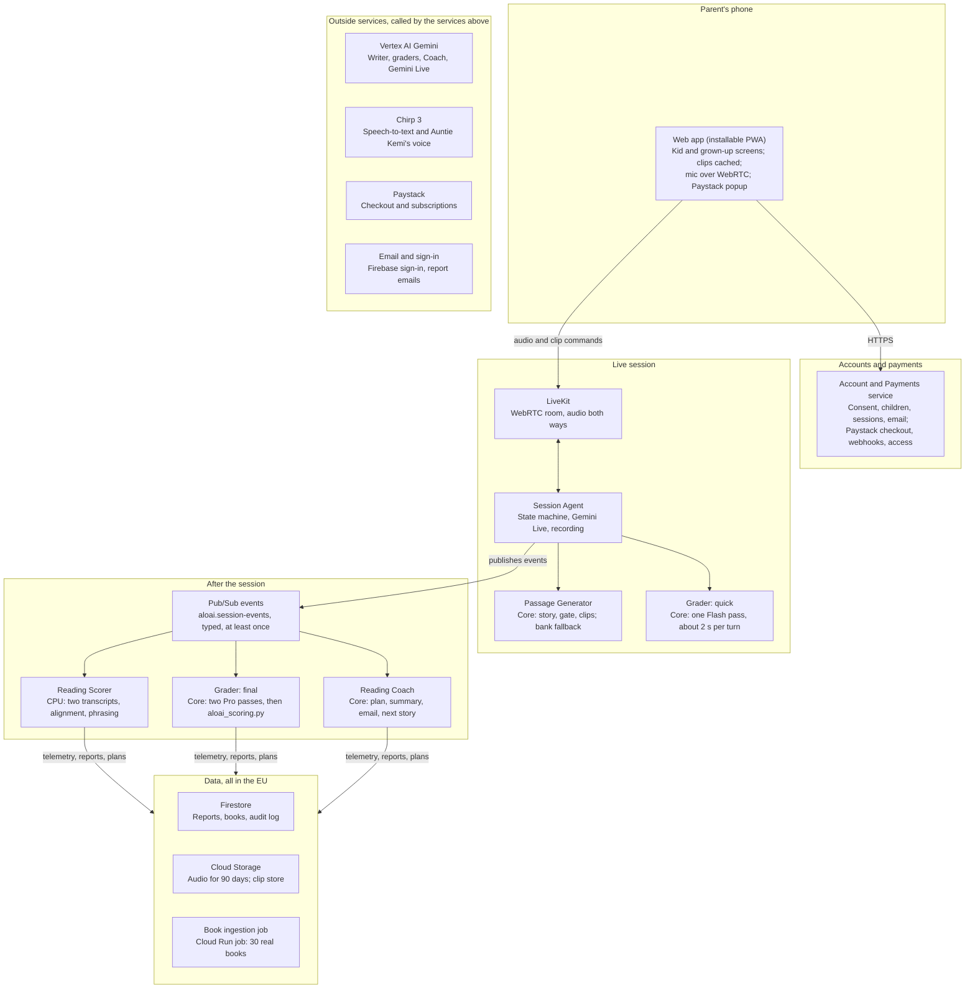
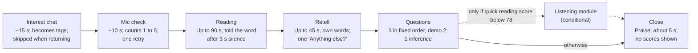
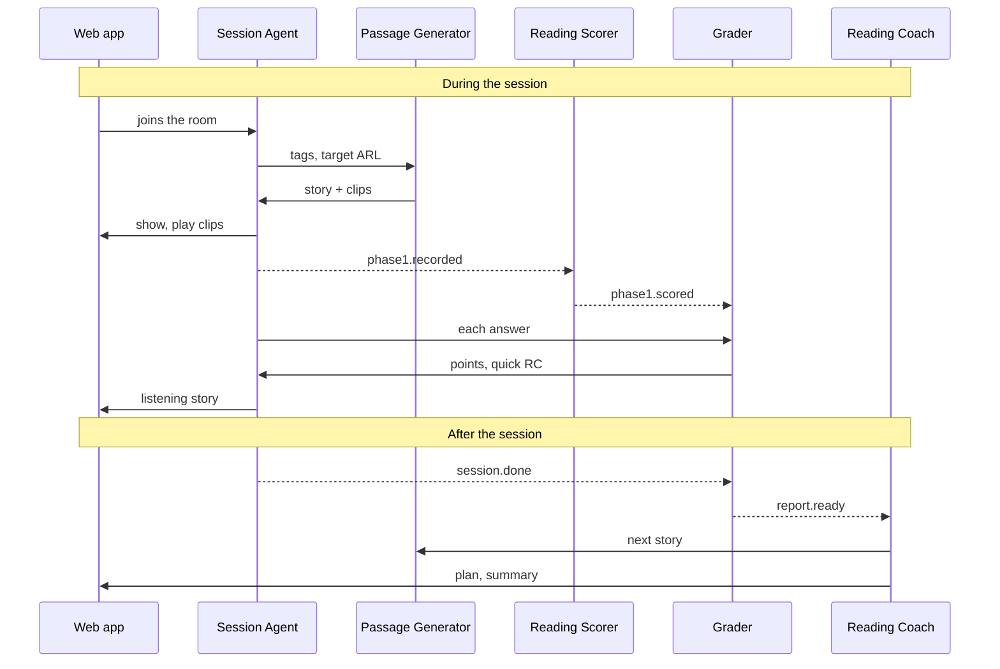

# Alo.ai Software Design Document

Oct 15, 2026 · @David

> **Markdown copy of `Software Design Document.pdf` (42 pages).** Converted for the team and for AI tools; the PDF is the original. The three diagrams are kept as images in `sdd-images/`, each with a caption and a text version. If this copy and the PDF disagree, tell the author and fix this file in a PR.

This document turns the Alo.ai PRD (v1.8.0) into a build design for the 6-day hackathon: a phone-browser web app, four Cloud Run services and one Cloud Run job in an EU region, a deterministic session engine, code-only scoring, and agents that plan but never score. It is written for the three-person build team; `LOCAL_DEV.md` covers running all of it on a laptop.

## 1. Scope and design goals

Version 1 delivers one journey end to end: a spoken reading check of about 3 to 4.5 minutes on a parent's phone that produces a report, a two-week plan and a spoken summary, with every score computed in code.

### Built in the sprint:

- Parent sign-in with Google or email, verified guardian consent, child profiles.

- Interest chat, a generated story (or a bank passage on fallback), a 5-second mic check, and oral reading with the live "That word is X." prompt.

- Retell, scripted questions, and the listening module when reading comprehension is low.

- The Reading Scorer on CPU (two transcripts that must agree, forced alignment, phrasing); two-pass Gemini Pro grading, the scoring library, the report and 3 books from a real 30-title catalogue.

- Reading Coach: two-week plan, spoken parent summary, next story queued, email. Paystack test-mode subscription that unlocks the weekly plan.

- Two server settings: `VOICE_MODE` (`cache_first` or `live_first`) and `SESSION_PROFILE` (`standard` or `demo`).

- Teacher view **preview**: front-end only, on fictional sample data.

**Designed here, built after the sprint:** the phone-level pronunciation check with the Nigerian English dialect allowlist (and the GPU it needs), the read-back step, offline local capture, adult-voice detection, the real teacher view and Teacher Assistant, school seat licences, partner-tutor split payments, the term pass and the remaining Paystack webhooks, BigQuery analytics, field-level KMS encryption, monitoring alerts, a separate prod project, the expression score with a Nigerian English voice, Lexile reporting (after a MetaMetrics licence), local norms and IRT calibration. Each has an interface hook in v1 so it can be added without a redesign.

### Constraints and what they force:

|Constraint|Source (PRD)|Design consequence|
|---|---|---|
|6 days, 3 people|14.2, 14.3|Managed services only; four Cloud Run services; one repository; one shared Python base image; a pre-agreed cut list; each owner runs the stack on a laptop with Docker Compose|
|A parent's Android phone on mobile data|1.1, 4.4|Installable web app; WebRTC Opus at 20–32 kbps; every clip for the session downloaded before reading starts; reconnect and resume|
|All processing in the EU|3, 12|`europe-west1` for compute, Chirp 3 in the `eu` multi-region, Firestore `eur3`; a documented NDPA transfer basis|
|Children's voice data|12|The microphone cannot open until a consent record exists; audio named by UUID only; deleted after 90 days|
|Judged "live, not a mock"; no faked functionality|14.1|Every demoed path runs on real services and real data; the teacher view preview is the only sample data and is labelled on every screen|
|No Nigerian English locale for ASR or TTS|4.6, 5.2|Two transcripts must agree before a word counts; word timings from forced alignment; a British voice; expression scoring off|
|US$400 of cloud spend for the whole hackathon|14.5|No GPU; scale to zero; all four services warmed only from the evening before the demo; recorded AI responses in CI and on laptops; budget alerts at $100, $200 and $300|

**Quality targets** (PRD 1.3, sprint values; p90 unless noted):

|Measure|Target|
|---|---|
|Agent turn latency (child stops speaking to agent audio)|Measured on day 3; ≤ 1.5 s|
|Passage generation and gate, partly hidden behind the mic check|≤ 20 s|
|Quick score per answer|≤ 2 s|
|Full report after session end (CPU scorer, Gemini Pro grading)|≤ 45 s|
|Reading Coach plan after the report|≤ 20 s|
|Child engagement time|≤ 3.5 min p50, ≤ 5 min max; demo profile ≤ 3 min|
|Words left out as uncertain (the transcripts disagree)|≤ 5% per session|
|WCPM, accuracy and answer scoring vs a human|Reported as early trial readings (n = 3–5)|
|Red-team cases passed|20 of 20|

### Design principles:

1. **Agents plan and act; code scores.** No model creates, changes or estimates a score, level or profile. `aloai_scoring.py` is the only source of numbers.

2. **The session order is deterministic.** A state machine, not an LLM, decides every prompt, so every child gets the same test.

3. **Raw audio is the only grading input.** It is recorded separately from Gemini Live and kept per phase and turn.

4. **Every number is traceable.** Reports store the versions and server settings that produced them; agent text is checked against tool results before anyone sees it.

5. **Fail kindly and keep going.** Each external dependency has a fallback that lets the session finish: a bank passage, scripted-clip mode, a quick-score timeout, reconnect and resume.

6. **Least privilege.** One service account per service, one secret per holder, data scope taken from the signed-in user's verified token, never from a model.

## 2. Architecture

Alo.ai splits into a live layer that must answer a child within about a second, and an after-session layer that turns the stored audio into scores, a report and a plan through events.

![Figure 1: Alo.ai architecture. The parent's phone runs the web app, which talks to the Account and Payments service over HTTPS and to LiveKit for audio and clip commands. The live session layer holds LiveKit, the Session Agent, the Passage Generator and the quick Grader. The Session Agent publishes events to Pub/Sub, which feed the Reading Scorer, the final Grader and the Reading Coach. These write telemetry, reports and plans to Firestore and Cloud Storage in the EU. Vertex AI Gemini, Chirp 3, Paystack and email and sign-in are outside services.](sdd-images/fig-1-architecture.png)

*Figure 1. The session runs live; every score is computed afterwards, in code, from stored audio. 4 services, 1 job, 17 components.*

<details>
<summary>Figure 1 as text</summary>



</details>

The phone talks to the Session Agent only through LiveKit. The agent calls the Core service (Passage Generator and quick grader) directly, and publishes events on Pub/Sub that the Reading Scorer and Core (final grading, then the Reading Coach) take from their own push subscriptions. Only Core's final grading runs `aloai_scoring.py`. Every service calls the Google AI services directly, in the EU, and each of the four services scales on its own.

## 3. Components

The system is one web app, four Cloud Run services and one Cloud Run job in the sprint, and two shared Python libraries. Each service scales on its own, so all four are warmed separately the evening before the demo (PRD 14.5). W1 (web app, accounts and payments), W2 (live session) and W3 (after the session) are the three workstream owners (PRD 14.2); the contracts between them are in section 11.

|Component|Job|Interface|Runtime|Owner|
|---|---|---|---|---|
|Web app (installable PWA)|Parent screens, session screen, report, checkout, teacher view preview|HTTPS to the services; WebRTC to LiveKit|Firebase Hosting; Firebase Auth|W1|
|Account and Payments service (`aloai-account`)|Consent records, child profiles, sessions, email; Paystack checkout, verification, webhooks and entitlements; the only holder of the Paystack secret and the email key|REST `/v1/sessions`, `/v1/children`, `/v1/consents`, `/v1/checkout`, `/internal/notify`; `POST` `/webhooks/paystack`|Cloud Run, CPU; min 0, min 1 for the demo|W1|
|Session Agent (`aloai-session-agent`)|Session state machine; LiveKit Agents worker with Silero VAD and turn detector; Gemini Live conductor; position tracker; records audio; emits events; reads `VOICE_MODE` and `SESSION_PROFILE`|LiveKit room; Pub/Sub publisher; calls Core|Cloud Run, CPU always allocated; laptops on days 1–2, min 1 from day 3|W2|
|Core service (`aloai-core`): Passage Generator|Interest tags to a gated, levelled story; clips from the shared clip store; bank fallback|REST `POST` `/v1/passages:generate`|Cloud Run, CPU; min 0, min 1 for the demo|W2|
|Core service: Grader|Quick scoring during the session; response-track ASR, two-pass Gemini Pro grading, report assembly and book ranking after it|REST `POST` `/v1/grade:quick`; Pub/Sub push (`session.done`, `phase1.scored`)|Same service|W3|
|Core service: Reading Coach|ADK agent: two-week plan, parent summary, next story, email|Pub/Sub push (`report.ready`)|Same service|W3|
|Reading Scorer (`aloai-reading-scorer`)|Phase 1 pipeline: two transcripts, forced alignment, miscue labels, prosody phrasing|Pub/Sub push (`phase1.recorded`); writes telemetry to Firestore|Cloud Run, 2 vCPU, 4 GiB, no GPU; min 0, min 1 for the demo|W3|
|Book ingestion job (`aloai-book-ingest`)|About 30 real books: text, licence, publisher level, embedding|Run by hand|Cloud Run job, built from the Core image|W2|
|Teacher Assistant (planned)|Class questions, groups and assignments from real records|Teacher view chat|Cloud Run, when built|—|
|`aloai_scoring.py`|Every formula: fluency, comprehension, profile, levels, flags|Python import (pure functions)|Inside Core's Grader|W3|
|`aloai_authz.py`, `aloai_guardrails.py`|Agent tool authorization; checks on agent text|Python import, called in the tool layer|Inside the Session Agent and Core|W3|

**External services:** Vertex AI (Gemini Flash and Pro, Gemini Live, text embeddings, the Gen AI evaluation service, safety filters), Cloud Speech-to-Text (Chirp 3), Cloud Text-to-Speech (Chirp 3 HD), LiveKit Cloud (WebRTC rooms), Paystack, Firebase Authentication (Google and email-link sign-in), and a transactional email provider.

**Shared code:** every Python service builds from one base image with the shared libraries, the JSON schemas from PRD section 10 and generated Pydantic models for them, so a schema change is one pull request that every service picks up. The same images run on laptops under Docker Compose (`LOCAL_DEV.md`).

## 4. Session engine

The Session Agent owns the order of every session through a pure state machine; the browser plays pre-cached clips on its command, and Gemini Live handles turn-taking, approved replies and, in `live_first` mode, the scripted lines it is allowed to speak.

### Client (web app, session screen):

- Joins a LiveKit room with a short-lived token from the Account and Payments service, publishing the microphone as an Opus track (mono, about 20–32 kbps).

- Measures levels while the child counts to five (RMS below −42 dBFS per 500 ms block, or clipping above 0.1% of samples, triggers one retry prompt). There is no VAD in the browser; end of speech is detected in the agent.

- Downloads every clip for the session into Cache Storage before reading starts: prompts, questions, the listening story, and one "That word is X." clip per distinct passage word from the shared clip store (about 80 clips, roughly 0.9 MB as 32 kbps MP3 on a first session; the bank-fallback clips download only if the fallback is used).

- Plays a clip when the agent sends `{"cmd":"play","clip_id":…}` on the LiveKit data channel, and acks with `played` or `missing`. Shows and hides the passage on `show_passage` / `hide_passage`, and shows Jàpá waiting on `reconnecting`. Never shows a score, timer or red mark.

### Session Agent:

- A LiveKit Agents worker on Cloud Run with CPU always allocated: on laptops on days 1–2 (Docker Compose with a local LiveKit server), then min 1 from day 3 so a session can start at any time. Cloud Run's default concurrency is kept.

- **Settings:** reads `VOICE_MODE` and `SESSION_PROFILE` from its environment (set in Terraform, never by the browser) when a session starts, and writes both to `sessions/{id}`.

- **End of speech:** LiveKit's Silero VAD plugin and turn detector, together with Gemini Live's `end_turn`.

- **Recording:** subscribes to the child's track and writes 16 kHz mono FLAC per phase and turn to `gs://aloai-audio-eu/{session_uuid}/{phase}/{turn}.flac`. This recording is independent of Gemini Live and is the only input to grading.

- **State machine as a pure function:** `step(state, event) -> (state, actions)`. The states are in the diagram below. Events include `turn_end(reason)`, `silence(ms)`, `passage_ready`, `passage_fallback`, `quick_score(result | timeout)`, `live_degraded`, `disconnected`, `reconnected`, `child_stop` and `timer`. Actions include `PlayClip`, `SpeakLive(text, fallback_clip)`, `StartRecording`, `StopRecording`, `ShowPassage`, `HidePassage`, `CallQuickScore`, `EmitEvent` and `SetLiveMode`. The session profile and voice mode are inputs to the machine, so both are unit-tested. A thin adapter executes the actions, so the whole protocol is tested without audio (PRD 13.5).

- **Position tracker (reading phase):** Chirp 3 `StreamingRecognize` partials are fuzzy-matched to the passage tokens to follow where the child is. 3.0 s of silence on the same word emits `PlayClip(word_clip[word_key])` and logs the word `TOLD`. "That word is X." is always a clip, in both voice modes. Reading is capped at 90 s.

- **Kindness and stop rules** are transitions, not prompts: fewer than 10 words correct in the first 30 s ends the reading and goes to the listening module; two silences over 8 s in one task move on; "stop" ends with praise and marks the session incomplete.

- **Dropped connection:** on `disconnected`, play the cached "Let's wait for the internet" clip and wait up to 30 s for LiveKit to reconnect. On `reconnected`, resume at the start of the current task and set `RECONNECTED`; an interrupted reading isn't repeated and is scored on the words read before the drop. Otherwise save, mark the session incomplete, and offer a new session later.

### Gemini Live's bounded role:

- Runs alongside in the same voice as the clips, with a fixed tool set: `end_turn(reason)` (ANSWERED, SILENCE, CHILD_ASKED_TO_STOP), `request_repeat(prompt_id)` once per prompt, `pause_session`, `move_on`, `end_kindly`, `switch_to_clips`. Every call becomes an event the state machine validates; a call the current state doesn't allow is ignored and logged.

- **Voice mode:** in `cache_first` (the default) it may only say phrases from an approved list ("Take your time.", "Thank you!"). In `live_first` it also speaks greetings, instructions, encouragement and questions from their exact text through `SpeakLive`; if it hasn't started within 1.5 s, the clip plays instead. It never speaks "That word is X.", the listening story, hints or judgements. Sessions in `live_first` carry `LIVE_FIRST`. **Fallback:** two turns over 2.5 s, or any Live error, switch the session to scripted-clip mode with VAD endpointing only, and set `LIVE_FALLBACK`. Children hear the same clips, so scores stay comparable.

### Session profile (PRD 4.1):

| |`standard` (default)|`demo`|
|---|---|---|
|Story|Blueprint length for the child's ARL|75 words (±5); other limits from the child's ARL|
|Questions|3 (2 literal, 1 inferential)|2 (1 literal, 1 inferential)|
|Listening module|When triggered: an 80–120-word story, retell, 2 items|When triggered: a ~50-word story, retell, 1 item|
|Flag|—|`DEMO_PROFILE`|

**The one decision made during the session** (PRD 7.4): run the listening module when the quick RC is below 78. If the quick score is late (6 s), run it anyway.


*Figure 2. Every child takes the same steps in the same order; only one step is conditional. The dashed step runs only when its condition holds; otherwise the session skips it. Session state machine: 7 steps, 1 conditional.*

<details>
<summary>Figure 2 as text</summary>



Rules in every step:

- Child says stop: end with praise, mark the session incomplete.
- Under 10 words right in 30 s: end the reading, go to listening.
- Two silences over 8 s in one task: move on.
- Gemini Live slow twice or failing: scripted-clip mode.
- Connection lost: wait up to 30 s, then resume the task, or save and offer a new session.

</details>

The Session Agent moves through these states one way only; the dashed step is decided by the quick score (or runs anyway if the score is late), and the rules in the box can end or shorten any step without changing the order.

## 5. Passage generation

The Passage Generator (in Core) turns at most two topic tags into a stored, gated passage with its clips in under 20 s, or returns a bank passage at the same level.

**Request** (from the Session Agent at the start of the interest chat): `{session_id, child_ref, target_arl, tags[≤2], detail?, genre_hint, voice_profile_id, length_profile: STANDARD | DEMO, deadline_ms: 20000}`. The child's own words are never sent: the agent maps the interest-chat transcript to tags with one Flash call against the fixed taxonomy, and keeps a detail only if it is a common noun that passes the safety check.

**Pipeline** (G1–G6 in PRD 4.5):

1. **Writer** (Gemini 2.5 Flash, structured output, pinned version): title, sentences, propositions with sentence indices (6–14; demo 4–8), items with rubrics and 0/1/2 exemplars (3; demo 2), from the blueprint row for the target ARL (75 words in the demo profile), the curated name list and a story-grammar template.

2. **Artifact build in code:** tokens and sentence indices, content-word flags, and syntactic boundaries for phrasing: punctuation plus a spaCy dependency parse (`en_core_web_sm`), turned into `PHRASE`, `CLAUSE` or `TERMINAL` after each token by a small tested rule. Names carry their IPA from the curated list, for the voice.

3. **Gate:** code checks first, then two Critic calls in parallel (table below). A failure goes back to the Writer **once**, with the failed checks as feedback.

4. **Audio from the shared clip store:** list the passage's distinct words, check which "That word is X." clips already exist, synthesise only the missing ones with Chirp 3 HD (at most 16 requests at once), and write each with an only-if-absent condition. Question clips go under the passage.

5. **Store:** the PassageArtifact (PRD 10.1) in Firestore `passages/{passage_id}` with its gate results and generation metadata. Passages hold no child data and are kept permanently.

|Gate check|Implemented as|
|---|---|
|Blueprint|Code: word count (demo 75 ± 5), mean sentence length, Zipf share (`wordfreq`), long-word share|
|Difficulty|Code: rule-based ARL text estimator within ±0.5 of the target|
|Safety|Vertex AI safety filters plus a blocklist|
|Names|Code: every proper noun on the curated list|
|Propositions|Code: 6–14 (demo 4–8), at least 3 core (demo 2), each traceable to its sentence|
|Inference is real|Code: the inferential 2-point answer isn't contained in, or a near-copy of, any single passage sentence (string check; no embedding)|
|Items answerable|Critic call A (Gemini Flash), given the passage, earns 2/2 on every item|
|Items not guessable|Critic call B (Gemini Flash), never given the story, earns ≤ 1 point on the literal items|

**Shared clip store** (`gs://aloai-clips-eu/{voice_profile_id}/{tts_version}/words/{word_key}.mp3`): full-sentence "That word is X." clips that every story reuses, not tied to any story, child or account. The key is the word lowercased, punctuation stripped, Unicode NFC with accents kept ("Jàpá" ≠ "Japa"); names and a short list of homographs ("read", "live", "wind") add the IPA used. `tts_version` changes whenever the voice settings change. A seeding script fills the store before the mini-study with the ~2,000 most common children's-book words, every bank-passage word and every curated name.

**Fallback:** if the gate still fails after the retry, or the deadline passes, the generator returns the best-matching bank passage at the same ARL and length profile (matching a tag if possible) with `FALLBACK_PASSAGE`. The bank holds 3 READ and 2 LISTEN passages, plus 1 of each at demo length, with their clips made at authoring time, so fallback costs no synthesis time.

**Pre-generation:** when a report is ready, the Reading Coach calls `queue_story`, which generates the child's next passage at `next_passage_arl` with their saved tags, so returning children skip the interest chat and never wait.

**Benchmark mode:** `passage_source = GENERATED | BANK` per session. School benchmarks default to BANK until the pilot shows the generated-versus-bank gap is small.

## 6. Speech scoring

The Reading Scorer turns the reading-phase audio into Phase 1 telemetry (PRD 10.2) on CPU, counting a word only where two transcripts agree and taking word timings from forced alignment.

**Trigger:** the Session Agent publishes `phase1.recorded` when the reading FLAC is closed. A Pub/Sub push subscription (600 s acknowledgement deadline) delivers it to the scorer; the handler finishes the work before it returns, and is idempotent on `session_id` (a redelivery that finds telemetry already written returns 200 and does nothing). It runs while the child does the retell and questions, so the telemetry is usually ready before the session ends.

### Pipeline:

1. **Load:** the FLAC from Cloud Storage and the PassageArtifact from Firestore.

2. **Two transcripts, in parallel:** Chirp 3 batch `Recognize` (passage names as speech adaptation; word confidence) and Gemini 2.5 Flash verbatim transcription (temperature 0, pinned). Both sit behind an `AsrProvider` interface.

3. **Forced alignment:** torchaudio `MMS_FA` on CPU aligns passage tokens to the audio, with a wildcard token absorbing insertions, giving start and end times for every passage word even where it was misread.

4. **Miscue labels:** each transcript is aligned to the passage by edit distance. Both have the passage word: CORRECT. Both have the same other word: SUBSTITUTION; both skip it: OMISSION; TOLD comes from the agent's log. If they disagree, or Chirp's confidence on an agreed-correct word is under 0.5, the word is UNCERTAIN and left out of the counts (more than 5% sets `HIGH_UNCERTAINTY`). An error followed within 3 s by the correct word is self-corrected. MISPRONUNCIATION and DIALECT_VARIANT aren't produced without the phone check.

5. **Counts and rates:** `fluency()` and `self_correction_ratio()` from `aloai_scoring.py`, so the scorer and the report use one implementation.

6. **Prosody (phrasing only):** pauses of 180 ms or more from Silero VAD, placed with the alignment timings and compared with the passage's stored spaCy boundaries, when accuracy is at least 90%. Expression stays null until a Nigerian English reference voice exists.

7. **Write:** telemetry to `sessions/{id}/phase1` and publish `phase1.scored`.

**Runtime (hackathon):** Cloud Run, 2 vCPU and 4 GiB, no GPU; min 0, and min 1 from the evening before the demo. An estimated 10–20 s per session (measure on day 1). `MMS_FA` and Silero VAD are baked into the image at pinned versions, and `model_versions` in the telemetry records every model and the scoring module version. The same image runs on laptops under Docker Compose.

**What this build gives up:** without the phone-level check, a misread that both transcripts "auto-correct" to the passage word can't be caught, and a Nigerian pronunciation is credited only as far as the ASR writes the intended word. The report and the pitch make no accent-aware claim.

**Designed for later:** the phone-level check (a wav2vec2 IPA phoneme model on each aligned word, on a GPU) with the dialect allowlist slots in after step 3 and adds MISPRONUNCIATION and DIALECT_VARIANT. Adult-voice detection (PRD 5.6) slots in after step 3 as a speaker-embedding comparison, setting `ASSISTED`. The expression score slots into step 6 once a reference voice exists.

## 7. Grading and scoring

The Grader (in Core) scores meaning twice: a fast single pass during the session that only decides whether the listening module runs, and a two-pass Gemini 2.5 Pro grading after it that feeds the report through `aloai_scoring.py`.

**Quick endpoint** (`POST /v1/grade:quick`, target ≤ 2 s p90):

- Request: `{schema_version, session_id, passage_id, turn_phase: RETELL | QUESTION, index, transcript}` (`schemas/grade_quick_request.schema.json`). `index` is the item's position in the passage, 0 for the retell. The agent calls it for every item, with an empty transcript when the child didn't answer, which scores 0 without a model call. The transcript is the live Chirp stream the agent keeps running through Phase 2.

- One Gemini Flash call, temperature 0, response schema `GraderOutput`, with the item's rubric and exemplars or the passage propositions.

- Each result is written to `sessions/{id}/quick/{turn_phase}_{index}`, because Cloud Run instances share no memory, so a repeated call returns the stored result. When the retell and every item are in (3, or 2 in the demo profile), the endpoint computes `quick_rc = comprehension_score(retell_coverage(…), item_score(…))`, stores it for the report, and returns `complete: true` with `run_listening_module` (PRD 6.5) (`schemas/grade_quick_response.schema.json`). The quick RC itself is never returned, so the Session Agent holds no [CAL] value.

Quick scores never appear in a report except side by side with final scores.

**Final grading** (on `session.done`, report ready ≤ 45 s p90):

1. **Response-track ASR** (Chirp 3) on every answer FLAC, batch and in parallel; low-confidence words are wrapped as `[?word?]`. A substantial difference from Gemini Live's input transcript on a scored answer sets `ASR_DISAGREEMENT`.

2. **Two independent Gemini 2.5 Pro passes** in parallel (Pro in development, rehearsals and the demo alike): temperature 0, pinned model, response schema `GraderOutput`, exemplars in shuffled order. Rules: score meaning only, accept Nigerian English and Pidgin, credit only what the passage supports, set `needs_review` on a creditable `[?word?]`.

3. **Reconcile:** items that differ get a third pass and the majority (all three differ: `GRADER_DISAGREEMENT`); retells use `combine_retell_passes(a, b, c)`: the mean if within 1.0, else the median of three, flagged if the spread stays above 2.0.

4. **Score in code** with `aloai_scoring.py`, in this order: `fluency` and `word_reading_ok` from the telemetry; `retell_coverage`, `item_score` and `comprehension_score` for RC (and LC if the listening module ran); `listening_outcome` for `LC_NOT_USED` or `LC_MISSED`; `assign_profile`; `performance_band`, `reported_level` and `next_passage_level`.

5. **Book recommendations:** Firestore vector search (`find_nearest`) with the embedding of the child's interest tags returns 15 candidates within the profile's band ±1; code ranks them by `0.50 × Fit + 0.30 × Sim + 0.20 × Culture` (PRD 9.3) and keeps 3.

6. **Assemble and write** the `ReadingReport` (PRD 10.4) to `reports/{session_id}` with every model, prompt and scoring version in `versions` and the session settings in `session_settings`. The report needs the telemetry too: whichever of grading or `phase1.scored` finishes second assembles it, inside a Firestore transaction, so it happens exactly once. Then publish `report.ready`. `parent_reporting` stays empty until the Reading Coach fills it.

**Scoring library contract:** pure functions, no I/O, no randomness, 100% line coverage (130 tests today). Every [CAL] constant lives in one versioned module; changing one needs a new `scoring_module` version, a rerun of the validation set and a PRD note. Core's Grader is the only code that imports the profile and level functions, so no other path can produce a score.

## 8. Agents after the session

The Reading Coach is the one post-session agent in the sprint: an ADK agent in the Core service that reads a finished report through tools, writes a plan and a parent summary, and can act only through an allowlisted, authorized tool layer whose output is checked in code.

**Reading Coach run** (triggered by `report.ready`, plan ready ≤ 20 s p90):

1. `get_report`, `get_history` (previous sessions, saved interests, last plan).

2. Choose 3 home activities from `get_activity_library` only (about 30 activities tagged by profile and level, following PRD section 8).

3. `search_books` for 3 books in the profile's band.

4. `queue_story` for the next passage at `next_passage_arl`: one saved interest plus one new topic.

5. `schedule_session` in 14 days, or 7 if the result was provisional or INSUFFICIENT_EVIDENCE.

6. Draft the parent summary (≤ 90 words) and home practice.

7. **Validate in code:** `validate_parent_summary(text, report, plan_numbers)` from `aloai_guardrails.py` rejects any number not in the report or plan, any banned term, and any text over 90 words. One rewrite on failure; a second failure uses the template summary and sets `COACH_TEMPLATE_USED`.

8. `save_plan` writes the plan and fills `parent_reporting`; Chirp 3 HD speaks the summary into a clip; `send_parent_email` sends "the report is ready" with no scores.

**Tool layer:** every tool call goes through `authorize(ctx, tool, args, state)` from `aloai_authz.py` before it runs.

- **Run context** is built by the server from the trigger, never by the model: the principal (the guardian), the one child this run is for, and whether consent is on file. The model supplies only business arguments, such as `child_id`, and each is checked against the context.

- **Policy:** a fixed allowlist per agent with an access type, a data scope and a per-run limit (`send_parent_email`: once per run). `FORBIDDEN_TOOLS` (write a score, change consent, charge or refund, run free-form SQL, and others) are refused for every agent, and a test proves it.

- **Budgets:** 30k tokens per Coach run; a feature flag per agent. With the Coach turned off, reports use the template summary and a default plan.

- **Audit:** every call is logged to the Firestore `audit_log` collection with agent, principal, tool, an argument hash, the decision and reason, the result size and a timestamp. Refusals are counted per agent; an alert on them comes with the pilot.

**Model and runtime:** Gemini on Vertex AI, version pinned per release; ADK in the Core service. In the hackathon the Coach shares Core's service account (IAM for Firestore, Text-to-Speech, and invoking the Account and Payments service's internal notify endpoint, which alone holds the email provider key). Its tool limits still come from `aloai_authz.py`, and it gets its own identity again when Core is split for the pilot.

**Teacher Assistant (planned, not built in the sprint):** an ADK agent in the teacher view answering class questions through fixed, parameterised queries (`query_class`, `get_child_reports`, `get_profiles`), with every claim cited and checked by `validate_teacher_answer`. User-visible writes (`propose_groups`, `propose_assignment`) need a single-use confirmation token: HMAC-signed, bound to the teacher, agent, tool and a hash of the exact proposal, valid for 10 minutes. The policy and token service are already in `aloai_authz.py` with tests; building it needs teacher accounts, rosters and teacher Firestore rules.

## 9. Web app, accounts and payments

One installable web app serves parents in kid and grown-up modes from the Alo.ai design system; parents sign in with Google or an email link through Firebase Authentication, and Paystack payments are created and confirmed only on the server.

### Screens:

|Screen|Mode|Notes|
|---|---|---|
|Landing|Grown-up|Sign up, sign in, "For schools (preview)" link|
|Sign-up and consent|Grown-up|Google or email sign-in, guardian attestation, consent text and version; the microphone stays locked until the consent record exists|
|Add child|Grown-up|First name, primary class, birth year; class confirmed each September|
|Child home|Kid|Jàpá, "Start reading", lanterns and stars (effort only, never scores)|
|Session|Kid|Speech bubble, mic button, passage panel in Andika, no timer or score; Jàpá waits while the connection comes back|
|Report|Grown-up|Profile in plain words, level, fluency and comprehension, phrasing, Auntie Kemi's spoken summary, plan, books, flags as "provisional"|
|Subscription|Grown-up|Plan choice, Paystack popup, entitlement status|
|Settings|Grown-up|Training opt-in (off by default), sign out; deleting a child's data is by request in the sprint, and the screen comes with the pilot|
|Teacher view preview|Grown-up|`/schools/preview`: the full preview (class table, groups, child page, assistant panel) on a static fixture, banner on every screen, no data calls|

### Sign-up flow:

1. The app signs the parent in with Firebase Authentication: Google, or an email link that verifies the address. No passwords, no SMS, and no sign-in endpoints of our own.

2. Every request then carries the Firebase ID token; services verify it and use its uid as `guardian_id`.

3. `POST /v1/consents` stores the attestation, consent text version, timestamp, sign-in method and verified email. `POST /v1/children` creates the child profile. The Session Agent refuses to start a session for a child with no consent record.

**Payments flow** (parent subscription, PRD 11.1):

1. The app calls `POST /v1/checkout {plan}` with the ID token. The Account and Payments service initializes the Paystack transaction server-side with the plan code (so the plan amount applies and nothing can be changed in the browser), stores `payments/{reference}` as PENDING, and returns the access code.

2. The app opens Paystack's inline popup with that access code.

3. Paystack calls `POST /webhooks/paystack`. The service checks `x-paystack-signature` (HMAC-SHA512 of the raw body with the secret key) and handles each event once (idempotent on reference), finishing before it returns 200.

4. On `charge.success` it calls Verify Transaction before writing `subscriptions/{guardian_id}` as active. It also handles `subscription.create`. The other lifecycle webhooks and the 15-minute pending-payment check come after the hackathon.

5. The app listens to the guardian's own subscription document and unlocks the weekly plan when it turns active.

**Entitlements:** the first check is free. The weekly plan and new stories need an active subscription (PRD 11.1), enforced by the Account and Payments service and the Session Agent from `subscriptions/{guardian_id}`, never by the browser.

**Teacher view preview:** a route in the same app reading one bundled JSON fixture ("P3B (sample)", 23 invented children across all 7 profiles). The assistant panel's suggested questions reveal pre-written answers; the free-text box and every changing action say "Coming soon". A unit test fails if the preview's code imports a data client or makes a network call.

## 10. One session end to end

A first session takes about 3 to 4.5 minutes of the child's time (2 to 2¾ in the demo profile); the scorer runs during the questions, the report follows within 45 s of the close and the plan within 20 s after that, with no step after the close needing the child.

![Figure 3: One session end to end. A sequence diagram across the web app, Session Agent, Passage Generator, Reading Scorer, Grader and Reading Coach. During the session: the web app joins the room, the agent sends tags and target ARL to the generator and gets a story and clips back, the web app shows and plays clips, the agent publishes phase1.recorded, the scorer publishes phase1.scored, each answer goes to the Grader which returns points and the quick RC, and a listening story may follow. After the session: session.done goes to the Grader, report.ready goes to the Reading Coach, which asks for a next story and sends the plan and summary to the web app.](sdd-images/fig-3-session-end-to-end.png)

*Figure 3. One quick score steers the session; the report is built from events. Solid: a call or reply. Dashed: a Pub/Sub event. Generator, Grader and Coach run in Core. One session: 13 messages across 6 components.*

<details>
<summary>Figure 3 as text</summary>



</details>

|Step|Time budget|What is stored|
|---|---|---|
|Join, interest chat, mic check|~25 s; the story is generated meanwhile (≤ 20 s)|`sessions/{id}` with its settings; the passage; any new clips in the shared store|
|Reading|60–90 s (demo 45–60 s)|Reading FLAC; TOLD words in the agent log|
|Phase 1 scoring|~10–20 s on CPU, during the retell and questions|Telemetry|
|Retell and questions|~105 s (demo ~55 s); each quick score ≤ 2 s|Turn FLACs and quick scores|
|Listening module, if needed|~90 s (demo ~40 s)|More turn FLACs|
|Final grading and report|≤ 45 s after the close|`reports/{session_id}`|
|Reading Coach|≤ 20 s after the report|Plan, spoken summary clip, next passage, email|

## 11. Interfaces

Public endpoints take a Firebase ID token; service-to-service calls use Cloud Run IAM (Google-signed OIDC tokens); Paystack's webhook is trusted only on a valid signature. All bodies are JSON validated against Pydantic models generated from the PRD schemas.

### HTTP endpoints:

|Service|Endpoint|Caller|Auth|Purpose|
|---|---|---|---|---|
|Account and Payments|`POST /v1/consents`|Web app|ID token|Store the guardian's consent record|
|Account and Payments|`POST /v1/children`, `GET` `/v1/children`|Web app|ID token|Create and list the guardian's children|
|Account and Payments|`POST /v1/sessions`|Web app|ID token|Check consent and entitlement, create the session, return a LiveKit room token and dispatch the Session Agent|
|Account and Payments|`POST /internal/notify`|Reading Coach (Core)|IAM|Send a templated email (no scores)|
|Account and Payments|`POST /v1/checkout`|Web app|ID token|Initialize a Paystack transaction, return the access code|
|Account and Payments|`POST /webhooks/paystack`|Paystack|HMAC-SHA512 signature|Receive payment and subscription events|
|Core (Passage Generator)|`POST /v1/passages:generate`|Session Agent, Reading Coach|IAM|Generate and gate a passage, or return a bank fallback|
|Core (Grader)|`POST /v1/grade:quick`|Session Agent|IAM|Quick score for one turn; the listening decision when complete|
|Reading Scorer, Core|`POST` `/pubsub/<subscription>`|Pub/Sub push|IAM (push service account)|Event handlers (below)|

Deleting a child's data is by request in the sprint (`ops/delete_child.py`); `DELETE /v1/children/{id}` comes with the pilot.

**Errors:** every endpoint returns `{error: {code, message, retryable}}`. Internal callers retry only `retryable` errors, with exponential backoff and a deadline, and every handler is idempotent on its request or event id.

**Events** (one topic, `aloai.session-events`, with a `type` attribute and one push subscription per consumer; handlers ignore types they don't handle; at-least-once delivery, 600 s acknowledgement deadline, dead-letter topic after 5 attempts):

|Event|Publisher|Consumer|Key fields|
|---|---|---|---|
|`session.started`|Session Agent|None in the hackathon (analytics later)|`session_id`, `child_ref`, `passage_id`, `context`, `voice_profile_id`, `voice_mode`, `session_profile`|
|`phase1.recorded`|Session Agent|Reading Scorer|`session_id`, `audio_uri`, `passage_id`, `told_token_indices`|
|`phase1.scored`|Reading Scorer|Core (report assembly)|`session_id`, `telemetry_ref`|
|`session.done`|Session Agent|Core (Grader)|`session_id`, `turn_audio_uris`, `capture_mode`, `session_settings`, `flags`, `listening_module_run`|
|`report.ready`|Core (Grader)|Core (Reading Coach)|`session_id`, `report_ref`, `profile`, `provisional`|
|`plan.ready`|Core (Reading Coach)|None in the hackathon (analytics later)|`session_id`, `plan_ref`, `template_used`|

Every event uses one envelope: `{event_id (UUID v4), type, schema_version, occurred_at, session_id, data}`. Paystack webhooks are handled directly by the Account and Payments service and never touch this topic.

### Agent tools (Reading Coach):

|Tool|Access|Input|Output|
|---|---|---|---|
|`get_report`|Read|`session_id`|The ReadingReport|
|`get_history`|Read|`child_id`|Past sessions, saved tags, last plan|
|`get_activity_library`|Read|`profile`, `arl`|Matching activity ids and texts|
|`search_books`|Read|`arl_min`, `arl_max`, `tags`|Ranked book ids with titles and licences|
|`queue_story`|Internal write|`child_id`, `arl`, `tags`|`passage_id`|
|`schedule_session`|Internal write|`child_id`, `days` (7 or 14)|Reminder id|
|`save_plan`|Internal write|`child_id`, the plan (JSON schema)|`plan_id`|
|`send_parent_email`|External write, once per run|`child_id`, `template_id`|Delivery id|

The session conductor's tools are listed in section 4.

**Contracts between workstreams.** The producer owns each contract; whoever changes one tags the consumer on the pull request before it merges, and bumps `schema_version`. Each has a schema in `schemas/` and a fixture in `fixtures/contracts/`, which the local stubs use and CI checks (`LOCAL_DEV.md`).

|Contract|Producer|Consumer|
|---|---|---|
|`POST /v1/sessions`: session record, LiveKit token, agent dispatch|W1|W2|
|Session protocol: data-channel commands (`play`, `show_passage`, `hide_passage`, `reconnecting`) and the clip list|W2|W1|
|Quick endpoint `POST /v1/grade:quick`|W3|W2|
|Events `phase1.recorded` and `session.done`, with turn audio paths, the TOLD log and the session settings|W2|W3|
|Passage artifact, including `syntactic_boundary_after`|W2|W3|
|`books/{book_id}` with its embedding|W2|W3|
|`ReadingReport` in `reports/{session_id}`|W3|W1|
|`queue_story` (Reading Coach to Passage Generator)|W2|W3|
|`/internal/notify` (Reading Coach email)|W1|W3|
|Entitlement in `subscriptions/{guardian_id}`|W1|W2|

## 12. Data design

Operational data, the audit log and the book embeddings live in Firestore (`eur3`), and audio, clips and book files in EU Cloud Storage buckets; browsers read their own documents and never write any. Nothing is exported for analytics in the hackathon.

### Firestore collections:

|Collection|Holds|Key fields|Written by|
|---|---|---|---|
|`guardians/{guardian_id}`|Parent account (id = Firebase uid)|email, sign-in method, created_at|Account and Payments|
|`consents/{consent_id}`|Verified consent record|guardian_id, child_id, text_version, attestation, sign_in_method, verified_email, timestamp, training_opt_in|Account and Payments|
|`children/{child_id}`|Child profile|guardian_id, first_name, primary_class, birth_year, saved_tags, next_passage_arl, level_confirmed|Account and Payments, Core|
|`sessions/{session_id}`|One session|child_id, status, context, capture_mode, voice_mode, session_profile, passage_id, passage_source, flags, voice_profile_id, created_at|Session Agent|
|`sessions/{id}/turns/{turn_id}`|One recorded turn|phase, audio_uri, live_transcript, asr_transcript|Session Agent, Core|
|`sessions/{id}/phase1`|Phase 1 telemetry (PRD 10.2)|as the schema|Reading Scorer|
|`sessions/{id}/quick/{turn_phase}_{index}`|Quick scores|points or credits, latency_ms|Core|
|`reports/{session_id}`|ReadingReport (PRD 10.4)|as the schema, plus child_id, guardian_id|Core (the Coach writes `parent_reporting` only)|
|`plans/{plan_id}`|Two-week plan|child_id, activity_ids, book_ids, next_session_at, template_used|Core (Reading Coach)|
|`passages/{passage_id}`|PassageArtifact (PRD 10.1)|as the schema; no child data|Core (Passage Generator)|
|`books/{book_id}`|Catalogue of about 30 real books|title, author, ARL (from the publisher level), tags, licence, attribution, description, `embedding` (vector field with a vector index)|Book ingestion job|
|`activities/{activity_id}`|Activity library|profile, ARL, text|Authoring script|
|`subscriptions/{guardian_id}`|Entitlement|plan_code, status, current_period_end, Paystack customer and subscription codes|Account and Payments|
|`payments/{reference}`, `webhook_events/{key}`|Payment state and webhook idempotency|status, amount, processed_at|Account and Payments|
|`audit_log/{id}`|Agent tool calls, report reads, consent changes, deletions|actor or agent, principal, tool or action, argument hash, decision, reason, timestamp|Every service|

**Security rules:** a signed-in guardian can read `guardians`, `children`, `sessions`, `reports`, `plans` and `subscriptions` documents whose `guardian_id` equals their uid. Clients write nothing; every write goes through a service. Teacher rules are added with teacher accounts.

**Cloud Storage** (all EU, uniform access, no public objects):

|Bucket|Contents|Retention|
|---|---|---|
|`aloai-audio-eu`|`{session_uuid}/{phase}/{turn}.flac`|Nearline after 30 days; deleted after 90. Training copies of opted-in audio come with the pilot|
|`aloai-clips-eu`|The shared clip store: `{voice_profile_id}/{tts_version}/words/…`, fixed prompts, and passage question clips|Word clips and prompts kept; generated-passage question clips deleted after 30 days|
|`aloai-books-eu`|`raw/`: source EPUB and PDF files|Kept, with licence and attribution|
|`aloai-tfstate-eu`|Terraform state|Versioned|

**Analytics (after the hackathon):** BigQuery `aloai_features` (per-session features keyed by an HMAC of `child_id`), `aloai_events` and `aloai_audit`, for norms and fairness audits. In the hackathon nothing leaves Firestore.

### Identifiers and personal data:

- Session and audio ids are UUID v4; nothing in a path names a child.

- First names and email addresses are encrypted at rest by Google. Field-level Cloud KMS encryption, decrypted only by the Account and Payments service and the Coach's email tool, comes with the pilot.

- **Deletion** is by request in the hackathon: `ops/delete_child.py` removes the child's audio, turns, telemetry, reports and plans, and writes the deletion to `audit_log`. The endpoint and its screen come with the pilot.

**Terraform:** the three buckets, the topic with its push subscriptions and dead-letter topic, the Firestore vector index on `books`, and the budget alerts are all in the flat configuration (PRD 15.1).

## 13. Security and privacy design

Three independent layers protect a child's data: Firebase identity on every user request, per-service IAM between services, and the agent authorization layer inside every agent tool; consent is checked in code before a microphone can open.

### Identity:

- **Parents:** Firebase Auth session from Google sign-in or a verified email link; ID tokens verified on every request (signature, audience, expiry). No passwords.

- **Services:** one Google service account each (Session Agent, Account and Payments, Reading Scorer, Core, and the ingestion job), with only the roles it needs; service-to-service calls use Cloud Run IAM and OIDC tokens. No service-account key files anywhere; CI uses Workload Identity Federation.

- **Agents:** run under their service's account (in the hackathon the Passage Generator, Grader and Coach share Core's) and never hold secrets; credentials live inside the tool implementations, and each agent's tool limits come from `aloai_authz.py`.

### Authorization layers:

|Layer|Enforced by|Example|
|---|---|---|
|User to data|Firestore rules and service checks on `guardian_id`|A guardian reads only their own children's reports|
|Service to service|Cloud Run IAM invoker roles|Only the Session Agent can call Core's quick endpoint|
|Agent to tool|`aloai_authz.py`: allowlist, scope from a server-built run context, per-run limits, `FORBIDDEN_TOOLS`|The Coach can't email twice in a run or read another child|
|Agent text to user|`aloai_guardrails.py`|Untraceable numbers and banned terms are blocked before a parent sees them|

**Secrets** (Secret Manager, EU replicas, values added outside Terraform):

|Secret|Only readable by|
|---|---|
|Paystack secret key|Account and Payments service|
|Email provider key|Account and Payments service|
|LiveKit API key and secret|Account and Payments service (room tokens), Session Agent (worker registration)|

**Consent gate:** `POST /v1/sessions` refuses a child with no consent record, and the Session Agent re-checks it when it joins the room. Training use of audio is a separate opt-in, off by default.

**Data residency and transfer:** all compute, storage and AI calls run in the EU (`europe-west1`; Chirp 3 in the `eu` multi-region). LiveKit and the email provider are chosen with EU data processing, and optional prompt or response logging and caching are turned off on Vertex AI. The NDPA transfer basis, DPIA and a Nigerian data-protection lawyer's review must be in place before any child outside the team's own families is recorded, which includes partner-school children in the mini-study (PRD 12).

**Input hardening:**

- **Prompt injection:** the child's interest-chat words become taxonomy tags only, so no child speech reaches a generator's instructions; transcripts given to graders are wrapped as data inside fixed instructions.

- **Webhooks:** signature checked on the raw body before parsing; events processed once; Verify Transaction before any entitlement.

- **Abuse:** Firebase Authentication's own sign-in protection. Firebase App Check and rate limiting come after the hackathon.

**Audit:** report reads, consent changes, deletions and every agent tool call are logged to the Firestore `audit_log` collection, with the authorization decision and reason for agent calls.

## 14. Deployment

Everything in Google Cloud is declared in one flat Terraform configuration, and every change reaches the cloud through the same pipeline: tests on the pull request, apply on merge.

**Environment:** one project, `aloai-dev`, which also runs the demo, with Terraform state in `aloai-tfstate-eu`. Paystack runs in test mode. A separate prod project, Terraform modules and drift checks come with the pilot.

**Laptops:** each owner runs their part with Docker Compose against the Firebase emulators (Auth, Firestore, Pub/Sub), a local Cloud Storage server and a local LiveKit server, using the same images as Cloud Run. AI calls are answered from fixtures unless `AI_MODE=live`, and the stubs for other owners' services are fixtures checked against the contract schemas (`LOCAL_DEV.md`).

**Repository layout** (one repository):

```
apps/web/
services/account/          # Account and Payments
services/session_agent/
services/core/             # generator/, books/, grader/ and coach/
services/reading_scorer/
libs/aloai/                # scoring, authz, guardrails, shared clients
schemas/  fixtures/  eval/  dev/
infra/                     # flat Terraform, including pubsub.json
ops/                       # paystack/, delete_child.py, README.md
docker-compose.yml  Makefile  .env.example
```

> **Note on this copy:** this layout is the team's agreed one (updated 2026-10-16). It replaces the layout printed in the PDF, which differs in small ways (shorter comments, and `pubsub.json` and `Makefile` are now named). `docs/LOCAL_DEV.md` and the repo skeleton use the same layout.

### Pipeline:

|Stage|Runs|Result|
|---|---|---|
|Pull request|Lint, types, unit, contract, authorization and guardrail tests; Compose integration tests with recorded AI responses; secret scan; `terraform fmt` and `validate`|Squash-merged by the reviewer, never the author, once green and approved (CONTRIBUTING.md)|
|Merge to main|Build the four images; push to Artifact Registry; `terraform` `apply` with the new image digests; smoke tests|The cloud project runs `main`|
|Before the demo|Every evaluation set against live models; three rehearsals on the venue's network; one recorded backup run|Go or no-go for the demo|

**Images:** one Dockerfile per service on a shared Python 3.11 base; the Reading Scorer adds ffmpeg, libsndfile, CPU-only PyTorch and its baked-in models. Images are referenced by digest, never by tag.

**Rollback:** re-apply the previous commit's digests through Terraform. In an emergency, move Cloud Run traffic back to the previous revision first (old revisions are kept), then make Terraform match the same day.

**Hackathon settings and budget** (US$400 for the whole hackathon; PRD 14.5). Nothing is sized for production: every service scales to zero unless it breaks without a warm instance, and Cloud Run's default concurrency is kept. **No GPU anywhere.**

|Service or setting|Hackathon value|Why|
|---|---|---|
|Session Agent|1 vCPU, 2 GiB, CPU always allocated; laptops on days 1–2; min 1 from day 3 (`agent_on`)|The LiveKit worker must be running to accept a session; about $2 a day|
|Reading Scorer|2 vCPU, 4 GiB, CPU only; min 0; min 1 from the evening of day 5 (`demo_warm`)|Without a GPU, warming costs cents|
|Core; Account and Payments|min 0, max 2; min 1 from the evening of day 5 (`demo_warm`)|A few seconds of cold start are fine while building, never on stage|
|`voice_mode`, `session_profile`|In `terraform.tfvars`; a change is a one-line pull request|The browser can't choose them; every change is reviewed|

Estimated total for 6 days: about $60–80, most of it AI calls at roughly $0.30–0.50 per live session. Laptops and CI use fixtures and cost nothing.

## 15. Reliability and operations

No single dependency failure stops a child's session: each has a fallback that finishes the session kindly and records a flag, and grading can always be re-run later from the stored audio.

### Failure modes:

|Failure|Detected by|Fallback|Flag|
|---|---|---|---|
|Story fails the gate or takes over 20 s|Generator deadline|Bank passage at the same ARL and length profile|`FALLBACK_PASSAGE`|
|Gemini Live slow (2 turns over 2.5 s) or erroring|Session Agent latency timer|Scripted-clip mode with VAD endpointing|`LIVE_FALLBACK`|
|Live hasn't started a line within 1.5 s (`live_first`)|Session Agent timer|The line's clip plays instead|—|
|Quick score over 6 s|Agent timeout|Run the listening module|—|
|A clip missing on the device|Client `missing` ack|Agent streams the clip from Cloud Storage|—|
|Connection lost mid-session|LiveKit disconnect|Cached "Let's wait" clip; resume at the start of the task within 30 s, else save and offer a new session|`RECONNECTED`|
|Poor audio after one retry|Mic check|Session continues; result not scored|`LOW_AUDIO` (blocking)|
|The two transcripts disagree on many words|Reading Scorer|Those words are left out as uncertain|`HIGH_UNCERTAINTY`|
|Reading Scorer or Core down|Pub/Sub retries, then the dead-letter topic|Report delayed; replay from the dead-letter topic once fixed; audio is already stored|—|
|Grader passes disagree|Reconciliation rules|Third pass; human review queue|`GRADER_DISAGREEMENT`|
|Coach summary fails the validator twice|Guardrail check|Template summary and default plan|`COACH_TEMPLATE_USED`|
|Paystack webhook delayed or repeated|Idempotency key; Verify Transaction|Entitlement set once; a pending-payment check comes after the hackathon|—|

### Monitoring (hackathon):

- **Budget alerts** at $100, $200 and $300 of the $400 (Terraform).

- **Logs:** structured JSON with `session_id`, `event_id` and `trace_id` on every line. No names, email addresses or transcripts in logs.

- **Watching:** per-session latency, fallback rates and the uncertain-word rate are read from the logs and Firestore during rehearsals. Dashboards and alert policies come with the pilot.

**Operations for the sprint team:** one owner is on call each day in rotation; the runbook in `ops/README.md` covers replaying the dead-letter topic, re-grading a session, switching off an agent with its feature flag, rolling back a service, changing a server setting, deleting a child's data on request, and rotating a secret. On demo day all three are on hand, with a recorded full run as the backup.

## 16. Testing and evaluation

Each component has a test that proves its own contract; agents are held to evaluation sets with pass thresholds; unit, contract and Docker Compose integration tests run on every pull request, and full journeys are run by hand at rehearsals (PRD 13.4–13.6).

|Component|Unit and contract|Integration|Evaluation or acceptance|
|---|---|---|---|
|Scoring library|130 tests today, 100% line coverage; every D × RC × LC combination maps to one profile|Used by the Grader tests|Matches hand scoring on the mini-study (early trial readings)|
|Session Agent|State machine as a pure function, 100% line coverage, including both profiles, both voice modes, reconnect, kindness, stop and fallback rules|Laptop sessions under Docker Compose with a local LiveKit server|Conductor checklist: 6 scenarios by hand at rehearsals|
|Passage Generator|Gate checks, spaCy boundary rule, clip-store keys, name and inference checks|Recorded AI responses in CI|Writer + Critic (Vertex AI evaluation service): ≥ 8 of 10 requests pass the gate; ≥ 9 of 10 seeded flaws caught|
|Reading Scorer|Miscue labels from two transcripts on synthetic alignments|Golden recordings (3 test recordings, then the 3–5 mini-study ones): WCPM within ±5 words, accuracy within ±3 points|Early trial readings vs hand counts|
|Grader|Reconciliation rules; schema validation of every recorded response|`make replay`: `session.done` to report on emulators|Mini-study answers vs hand scores (κ reported; target ≥ 0.60)|
|Reading Coach|Tool layer, validator|`report.ready` to plan on emulators|ADK evaluation, 10 reports: correct tools ≥ 9, library-only activities 10, first-try validator pass ≥ 9|
|Authorization and guardrails|Policy, forbidden tools, tokens, banned terms, untraceable numbers|Wired into the tool layer tests|Red-team set: 20 cases, 20 passed|
|Account and consent|Consent and entitlement checks|Firebase Auth and Firestore emulators; rules tests (a guardian can't read another family's child)|—|
|Payments|Signature check, idempotency|Paystack test mode with `make webhook`: signed `charge.success`, entitlement; forged and duplicate webhooks rejected|Test-mode payment unlocks the plan|
|Web app|Component tests; the preview imports no data client|`make smoke`|Full journeys by hand at rehearsals, in both voice modes and both profiles|

**Determinism in CI and on laptops:** Gemini, speech-to-text and text-to-speech responses are recorded once and replayed (`AI_MODE=fixtures`), so runs are fast, free and repeatable. Recordings carry the model and prompt version, and a version change forces a re-record. Evaluation sets run against live models before the demo and whenever a prompt or model changes.

**Gates:** a pull request merges only when every test above that runs on pull requests is green. Nightly live runs, the regression gate, Playwright journeys and the load test come with the pilot.

## 17. Design decisions

Twenty-two choices shape this design; each is reversible only at the cost shown, so changing one needs a PRD changelog entry.

|#|Decision|Alternative rejected|Why|
|---|---|---|---|
|D1|A deterministic state machine owns the session order|An LLM orchestrating the session|Every child must get the same test, and a pure function can be unit-tested|
|D2|Code computes every score; agents only read them|LLM-produced scores|LLM item scoring explains too little variance on its own (PRD 7.3); code is traceable and repeatable|
|D3|Scripted lines play as clips by default; `live_first` lets Gemini Live speak them, never "That word is X."|Gemini Live speaking every line, including the told word|Names need IPA overrides Live can't take; identical questions for every child; the told word must be instant and exact, because its wait counts as reading time|
|D4|Word timings come from forced alignment; two transcripts must agree before a word counts|Trusting one ASR|No Nigerian English locale; one ASR can't tell a misread from an accent or an auto-correction|
|D5|No phone-level check in the hackathon; the dialect allowlist waits for it|A phone-level check on a GPU|Saves about 3 days and the GPU; costs auto-correction detection and accent-aware credit, so no accent claim is made|
|D6|Generated passages behind a gate, with a bank fallback|A fixed passage bank only|Interest-matched stories engage children; the gate, stored features and benchmark mode control comparability|
|D7|A quick single pass in-session for the listening decision, two Gemini Pro passes after|One pass for everything|The in-session decision needs about 2 s; reported scores need reliability|
|D8|One installable web app|WhatsApp bot or native apps|No install; WebRTC audio; inline Paystack checkout; one codebase for three people|
|D9|Google voices now, behind a `VoiceProvider` interface; expression scoring off|Waiting for a Nigerian voice|Ship now; a British reference voice would penalise normal Nigerian intonation|
|D10|All processing in the EU|`us-central1`|Chirp 3 runs only in the `us` and `eu` multi-regions; the EU is closer to Lagos; needs an NDPA transfer basis|
|D11|One event topic with typed events and push subscriptions|A topic per event type|Fewer resources to manage; one envelope; one dead-letter path|
|D12|Firestore for operational data, the audit log and book vectors; BigQuery later|A relational database|Serverless, security rules for direct client reads, local emulators, built-in vector search|
|D13|Terraform for all infrastructure, one flat configuration in the hackathon|Console and `gcloud` scripts|Reviewable changes; settings such as the voice mode change through a reviewed one-line pull request|
|D14|The teacher view is a labelled preview in v1|Building the full teacher view|Three people and 6 days; judges score live, not mock, so it is shown as a preview|
|D15|Alo Reading Level as the reported scale; Lexile only after a MetaMetrics licence|Estimating Lexile measures|Lexile reporting needs a licence, and MetaMetrics prohibits derivative equivalent scales|
|D16|Paystack transactions initialized and verified on the server|Client-side checkout amounts|Amounts and plans can't be changed in the browser; access is granted only on a verified charge|
|D17|Google and email-link sign-in through Firebase Authentication|SMS codes|No SMS provider, cost or key during the hackathon, and Google is one tap; the pilot may need a stronger consent check|
|D18|Four Cloud Run services, each scaled on its own|Seven services, or one monolith|Fewer moving parts than seven; the Session Agent and scorer can still be warmed separately, and the scorer's heavy image stays away from logins and webhooks|
|D19|Pub/Sub between services|In-process background tasks|On Cloud Run, work after a response can be cut off; a push subscription makes each step a request that finishes, with retries and a dead-letter topic|
|D20|`VOICE_MODE` and `SESSION_PROFILE` as server settings in Terraform|Choosing them in the browser|The server decides and records every session's mode; changes are reviewed|
|D21|A shared clip store of full-sentence "That word is X." clips per voice|130 new clips per story, or a stored "That word is" joined to a word clip|Each word is made once; a whole sentence sounds natural; nothing in the store is tied to a child|
|D22|Docker Compose for local development, with contract fixtures|Building only against the shared cloud project|Each owner tests their own flow alone and for free, with stubs checked against the same schemas as production|

## 18. Risks and open questions

The biggest risk is time: three people in 6 days, which the day-3 checkpoint and the pre-agreed cut list (PRD 14.2) are there to absorb.

|Risk|Impact|Mitigation|Owner|
|---|---|---|---|
|Three people can't finish in 6 days|High|Day-3 checkpoint; cut list (`live_first`, phrasing, reconnect); nothing on the "never cut" list is touched|All|
|ASR is poor on Nigerian children's speech|High|Two transcripts must agree, disagreements left out; 30-minute check on day 1; golden recordings|W3|
|Accuracy reads high when both transcripts auto-correct a misread|Medium|No accent or accuracy claims; early trial readings against hand counts; the phone check in the pilot|W3|
|Venue network fails on demo day|High|Three rehearsals on the venue's network; a phone hotspot; a recorded full run|All|
|Gemini Live turn latency from Lagos to the EU|Medium|Measure on day 3; `cache_first` by default; scripted-clip fallback keeps the session comparable|W2|
|The demo session overruns its 3-minute slot|Medium|Demo profile; a fluent demo reader; the recorded backup|W2|
|Low gate pass rate on generated stories|Medium|Tune prompts on the 10-request set; switch the Writer to Pro; bank fallback at both lengths|W2|
|W2 carries the most work|Medium|Book ingestion moves to W3 first if W2 slips|All|
|Legal basis not ready for children outside team families|Medium|Keep the mini-study to team families|W1|
|Grader agreement low on the mini-study|Medium|Report as early trial readings with the raw numbers; human review queue for disputed items|W3|
|Cloud spend runs past $400|Low|No GPU; scale to zero; warm only from the evening of day 5; budget alerts at $100, $200 and $300; fixtures in CI and on laptops|W1|

### Open questions:

- Which Chirp 3 HD voice is Auntie Kemi? (day 1 listening test)

- Which Chirp 3 locale (`en-GB` or `en-US`) gives the better transcript? (day 1 check)

- Does `live_first` sound natural enough to show on stage, or does the demo stay `cache_first`? (day 4)

- Which LiveKit Cloud region keeps media processing in the EU?

- Which email provider, with EU data processing?

- Which CI provider runs the pipeline?

- Final prices for the monthly plan, term pass and school seats.

- When the MetaMetrics licence and its linking study start, and which pilot data they need.

## 19. Traceability

Every PRD section that asks for something to be built maps to a section here; the PRD stays the source of truth for rules and constants, and this document for how they are built.

|PRD section|Requirement|SDD section|
|---|---|---|
|1.2–1.3|Product objective, KPIs and engineering targets|1|
|3, 3.1|Architecture, agents and orchestration|2, 3, 8|
|4.1–4.3|Session flow, session profile, voice mode, stop and kindness rules|4, 10|
|4.4|Web app delivery, device and connection requirements|4, 9|
|4.5|Personalised passage generation and the gate|5|
|4.6|Voice profile and `VoiceProvider`|4, 5, 17 (D9)|
|4.7|Teacher view preview|9, 17 (D14)|
|5.1–5.6|Ingestion, two transcripts, reading pipeline, prosody; the deferred dialect allowlist and adult-voice detection|6|
|6.1–6.8|Scoring engine and flags|7, 15|
|7.1–7.4|Grader and quick scoring|7|
|8, 9|Profile actions, book catalogue and ranking|7, 8|
|10.1–10.4|Data contracts|11, 12|
|11|Paystack payments|9, 11|
|12, 12.1|Privacy, security and agent authorization|8, 13|
|13.1–13.6|Validation, evaluation, testing and CI gates|16|
|14.1–14.5|Demo scope, team, 6-day plan, budget and local development|1, 3, 14, 18|
|15|Deployment and Terraform|14|

**References:** Alo.ai PRD v1.8.0; the team's one-page Git guideline (CONTRIBUTING.md); the local setup guide (LOCAL_DEV.md); companion code `aloai_scoring.py`, `aloai_authz.py`, `aloai_guardrails.py` and `tests/` (130 tests); the Alo.ai brand design system.
